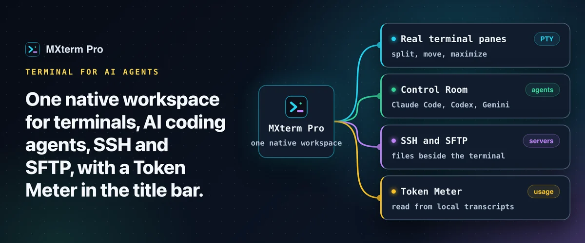
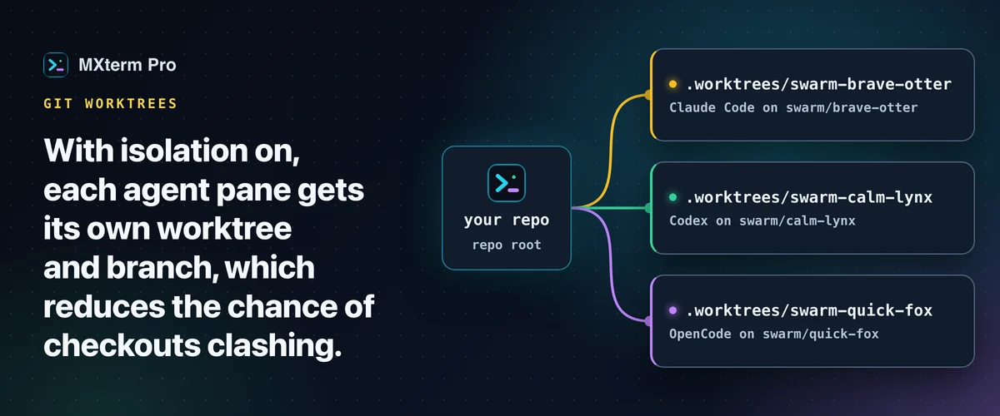

# MXterm Pro: the terminal for AI coding agents, SSH and SFTP

**One native workspace for terminals, agents, SSH/SFTP and the work around your servers.** MXterm Pro runs [Claude Code, Codex, Gemini CLI](https://mxterm.net/agents) and 24 other coding-agent CLIs in real terminal panes, next to your SSH sessions and a remote file browser, with a [Control Room](https://mxterm.net/features/war-room) so agents can talk to each other and a [Token Meter](https://mxterm.net/features/token-meter) that shows how much of your usage window is gone.

&nbsp;

      
 Claude Code · Codex · Gemini CLI · GitHub Copilot · Cursor Agent · Qwen Code · Amp · and 20 more

---

## What it does

| | | |
| --- | --- | --- |
| 🪟 | **Real terminal panes** | Split, move between tabs and maximize. Every pane is a real PTY, not a wrapper. → [Run Claude Code and Codex in split panes](docs/split-terminal.md) |
| 🎛️ | **Control Room** | Agents in separate panes join a shared room, message each other and hand off tasks while you watch. → [Control Room guide](docs/control-room.md) |
| 🌿 | **One git worktree per agent** | An opt-in setting gives every agent pane its own branch and checkout. → [Git worktrees guide](docs/git-worktree.md) |
| 📂 | **SSH and SFTP beside the terminal** | Saved hosts, a remote file browser, an in-app editor, remote grep and a chmod grid. → [SFTP GUI guide](docs/ssh-sftp.md) |
| 🗄️ | **Fleet tools** | Host groups, config import, broadcast to many panes and a live CPU/RAM/disk bar, with no agent on the server. → [Manage 50+ servers](docs/manage-ssh-servers.md) |
| 🔢 | **Token Meter** | Reads the token counts your agents already write to disk and shows them in the title bar. → [Token Meter guide](docs/token-meter.md) |
| ⚡ | **Command Recipes** | Ready-made Linux commands on `Cmd+J`. A keyword match, not an AI model. → [Command Recipes guide](docs/command-recipes.md) |
| 📱 | **Control from your phone** | Pair a phone, tablet or browser by code and steer the panes you share. Phone control is free. → [Remote access guide](docs/remote-access.md) |

> **The problem it solves:** an agent is working in one terminal, the server you deploy to is in another, and you keep switching windows to see whether the first one is about to hit its usage limit. MXterm Pro puts the agents, the servers and the usage in one place.

## See it in action

  
  

  
  

## Download & install

MXterm Pro runs on macOS 10.15+ (Apple Silicon and Intel), Windows 10/11 x64 and Linux (64-bit, Ubuntu 22.04 or later; beta). On phones, Android is available; iPhone, iPad and Apple Watch are in beta.

| Method | How |
| --- | --- |
| **Direct (recommended)** | [**mxterm.net/download**](https://mxterm.net/download): macOS `.dmg` (signed with an Apple Developer ID and notarized), Windows installer, or Linux `.deb` / AppImage. |
| **Homebrew (macOS)** | `brew trust mxtermpro/mxterm && brew install --cask mxtermpro/mxterm/mxterm-pro`, from the [`homebrew-mxterm`](https://github.com/mxtermpro/homebrew-mxterm) tap. |
| **Phone** | Android on Google Play or as an APK; iPhone and iPad through TestFlight beta. See [mxterm.net/download](https://mxterm.net/download). |

The Windows installer and the Linux packages are not code-signed yet; on Windows, SmartScreen may warn the first time. MXterm Pro updates itself from inside the app on macOS and Windows; on Linux you download the new version. → [Install guide and first-launch warnings](docs/install.md)

## Guides

### 🚀 Getting started

| | Guide | In one line |
| --- | --- | --- |
| ⬇️ | [Install MXterm Pro on macOS, Windows and Linux](docs/install.md) | Download, first launch and updates on macOS, Windows and Linux. |
| 📡 | [Remote access to your MXterm Pro host: Tailscale, LAN and port 6868](docs/remote-access.md) | Tailscale, LAN and port 6868 for the remote host. |

### 🤖 Run several AI agents

| | Guide | In one line |
| --- | --- | --- |
| 🪟 | [Run Claude Code and Codex in split terminal panes](docs/split-terminal.md) | Two agents, two panes, one repo, no checkout fights. |
| 🎛️ | [Control Room: run Claude Code, Codex and Gemini CLI together](docs/control-room.md) | Let agents message each other and hand off tasks. |
| 🌿 | [One git worktree per AI agent](docs/git-worktree.md) | Give every agent pane its own branch and checkout. |
| 🖱️ | [Run Cursor Agent in a multi-pane terminal](docs/cursor-agent.md) | Cursor's CLI agent with a live status dot. |

### 🖥️ SSH, SFTP and servers

| | Guide | In one line |
| --- | --- | --- |
| 📂 | [SFTP GUI and remote editor beside your terminal](docs/ssh-sftp.md) | Edit, search and chmod remote files beside the terminal. |
| 🗄️ | [Manage 50+ SSH servers and cloud VMs on a Mac](docs/manage-ssh-servers.md) | Groups, import, broadcast and live server stats. |
| ⏱️ | [Prevent SSH connection timeouts on your MacBook](docs/ssh-keepalive.md) | Keepalive settings that work, and the timeouts they cannot fix. |
| 🔌 | [SSH port forwarding GUI: add local forwards on an open tab](docs/ssh-port-forwarding.md) | Add and cancel local forwards on an open SSH tab. |
| 🐳 | [Docker build terminal on Mac, beside your SSH deploy](docs/docker-ssh-deploy.md) | Build in one pane, deploy over SSH in the next. |
| 🦙 | [Run Ollama in a terminal alongside SSH sessions](docs/ollama-ssh.md) | Local models and remote servers in one workspace. |

### 📊 Usage, limits and shortcuts

| | Guide | In one line |
| --- | --- | --- |
| 🔢 | [Token Meter: Claude Code and Codex usage in the title bar](docs/token-meter.md) | Tokens used, read from your agents' own transcripts. |
| 💳 | [Check AI API credit balance from your terminal](docs/ai-credit-balance.md) | Money, quota or spend: what each provider reports. |
| ⚡ | [Command Recipes: ready-made Linux commands on Cmd+J](docs/command-recipes.md) | Ten kinds of Linux task on one shortcut. |

Every guide is the quick version of a full write-up on [mxterm.net/blog](https://mxterm.net/blog). The index with previews is in [docs/README.md](docs/README.md).

## Why MXterm Pro

MobaXterm, iTerm2 and Termius are excellent tools. MXterm Pro is built for a narrower job: running several AI coding agents next to your servers, with usage visible. Side-by-side pages: [vs iTerm2](https://mxterm.net/vs/iterm2) · [vs MobaXterm](https://mxterm.net/vs/mobaxterm) · [vs Termius](https://mxterm.net/vs/termius) · [vs Warp](https://mxterm.net/blog/mxterm-pro-vs-warp-terminal).

## FAQ

**Is MXterm Pro free?**
Yes. The Free plan has no limit on terminal panes. It includes up to 5 saved SSH hosts, a Control Room with 2 agents, git worktree isolation, the Token Meter and Command Recipes. Pro removes the limits on hosts, rooms and members. It is a one-time payment, not a subscription. See [pricing](https://mxterm.net/pricing).

**Does MXterm Pro install Claude Code or Codex for me?**
No. Install the agent CLIs you want and sign in with your own account. MXterm Pro runs them in panes. → [Install guide](docs/install.md)

**How do I run two agents without them breaking each other's files?**
Tick **Isolate features in git worktrees** so each agent pane gets its own branch and checkout. → [Git worktrees guide](docs/git-worktree.md)

**Does the Token Meter send my usage anywhere?**
By default it only reads the transcripts each agent already keeps on your disk, and for token counts nothing is sent anywhere. Optional switches for plan limits and account balances contact the provider and are off until you turn them on. → [Token Meter guide](docs/token-meter.md)

**Can I edit files on a remote server?**
Yes. Open a saved SSH host and the SFTP panel docks beside the terminal, with a Monaco editor, remote grep and a chmod grid. → [SFTP GUI guide](docs/ssh-sftp.md)

**Does it run on Windows and Linux?**
Yes. Windows 10/11 x64 is public; its installer is not code-signed yet, so SmartScreen shows an Unknown publisher on first run. Linux (Ubuntu 22.04 or later, `.deb` or AppImage) is a beta. → [Install guide](docs/install.md)

## Alternatives & related projects

MXterm Pro is a closed-source desktop app. If you want something fully open-source, or simpler, these are good places to start:

- [iTerm2](https://github.com/gnachman/iTerm2): the long-standing macOS terminal (GPL-2.0) with split panes, tmux integration and a Python API.
- [tmux](https://github.com/tmux/tmux): the standard terminal multiplexer (ISC), free and scriptable, runs everywhere.
- [Ghostty](https://github.com/ghostty-org/ghostty): a fast, feature-rich, cross-platform terminal emulator (MIT).
- [Tabby](https://github.com/Eugeny/tabby): a configurable terminal with SSH and serial support (MIT).
- [Wave Terminal](https://github.com/wavetermdev/waveterm): an open-source, AI-integrated, cross-platform terminal (Apache-2.0).

Browse more in the [`terminal-emulator`](https://github.com/topics/terminal-emulator) and [`ai-agents`](https://github.com/topics/ai-agents) topics on GitHub.

## Support

- 🐞 **Bugs and help:** [open an issue](https://github.com/mxtermpro/Mxterm/issues/new/choose)
- 💬 **Questions and ideas:** [Discussions](https://github.com/mxtermpro/Mxterm/discussions)
- 🌐 **Everything else:** [mxterm.net](https://mxterm.net) · [Help center](https://mxterm.net/help) · [Changelog](https://mxterm.net/changelog) · support@mxterm.net

## Connect

Follow MXterm Pro for release notes and tips.

  
  
  

---

MXterm Pro is a closed-source app. This repository hosts its docs and community support.

