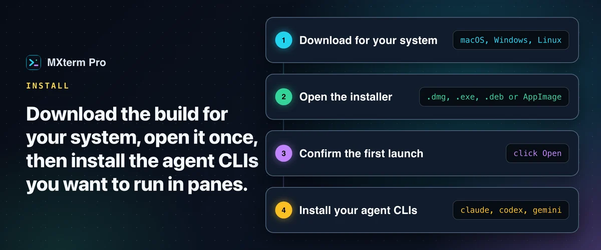
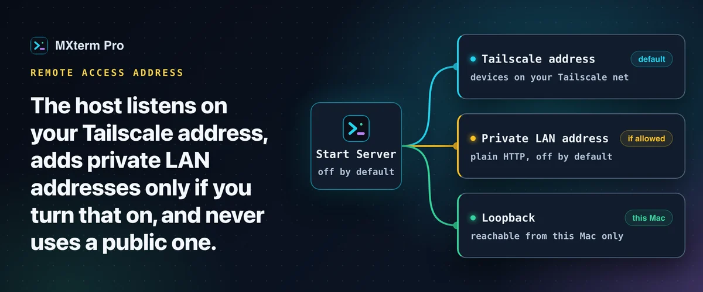
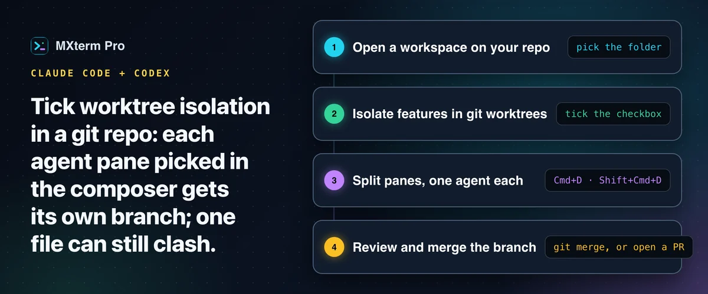
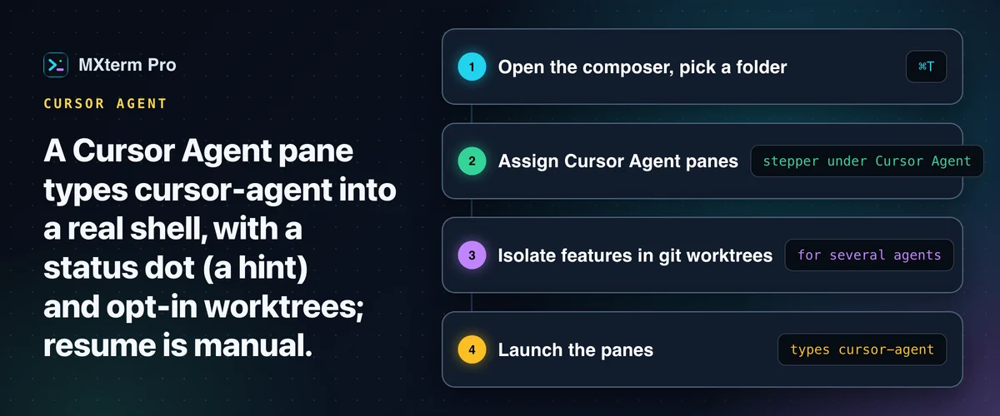
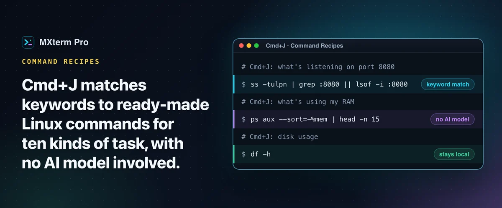

# MXterm Pro guides

Fifteen short, practical guides for running AI coding agents, SSH and SFTP in one native workspace. Each page is the quick version; the full write-up for every topic lives on [mxterm.net](https://mxterm.net/blog).

## 🚀 Getting started

### ⬇️ [Install MXterm Pro on macOS, Windows and Linux](install.md)

Download, first launch and updates on macOS, Windows and Linux.

### 📡 [Remote access to your MXterm Pro host: Tailscale, LAN and port 6868](remote-access.md)

Tailscale, LAN and port 6868 for the remote host.

## 🤖 Run several AI agents

### 🪟 [Run Claude Code and Codex in split terminal panes](split-terminal.md)

Two agents, two panes, one repo, no checkout fights.

### 🎛️ [Control Room: run Claude Code, Codex and Gemini CLI together](control-room.md)

Let agents message each other and hand off tasks.

### 🌿 [One git worktree per AI agent](git-worktree.md)

Give every agent pane its own branch and checkout.

### 🖱️ [Run Cursor Agent in a multi-pane terminal](cursor-agent.md)

Cursor's CLI agent with a live status dot.

## 🖥️ SSH, SFTP and servers

### 📂 [SFTP GUI and remote editor beside your terminal](ssh-sftp.md)

Edit, search and chmod remote files beside the terminal.

### 🗄️ [Manage 50+ SSH servers and cloud VMs on a Mac](manage-ssh-servers.md)

Groups, import, broadcast and live server stats.

### ⏱️ [Prevent SSH connection timeouts on your MacBook](ssh-keepalive.md)

Keepalive settings that work, and the timeouts they cannot fix.

### 🔌 [SSH port forwarding GUI: add local forwards on an open tab](ssh-port-forwarding.md)

Add and cancel local forwards on an open SSH tab.

### 🐳 [Docker build terminal on Mac, beside your SSH deploy](docker-ssh-deploy.md)

Build in one pane, deploy over SSH in the next.

### 🦙 [Run Ollama in a terminal alongside SSH sessions](ollama-ssh.md)

Local models and remote servers in one workspace.

## 📊 Usage, limits and shortcuts

### 🔢 [Token Meter: Claude Code and Codex usage in the title bar](token-meter.md)

Tokens used, read from your agents' own transcripts.

### 💳 [Check AI API credit balance from your terminal](ai-credit-balance.md)

Money, quota or spend: what each provider reports.

### ⚡ [Command Recipes: ready-made Linux commands on Cmd+J](command-recipes.md)

Ten kinds of Linux task on one shortcut.

## More on mxterm.net

- [Blog](https://mxterm.net/blog) · [Docs](https://mxterm.net/docs) · [Help center](https://mxterm.net/help) · [Changelog](https://mxterm.net/changelog)
- Compare: [MXterm Pro vs iTerm2](https://mxterm.net/vs/iterm2) · [vs MobaXterm](https://mxterm.net/vs/mobaxterm) · [vs Termius](https://mxterm.net/vs/termius)
- [Download MXterm Pro](https://mxterm.net/download) for macOS, Windows and Linux

## About

[MXterm Pro](https://mxterm.net/) is a desktop app for macOS, Windows and Linux: real terminal panes, a Control Room for AI coding agents, and SSH/SFTP in one native workspace. Questions: [Discussions](https://github.com/mxtermpro/Mxterm/discussions) or support@mxterm.net.
