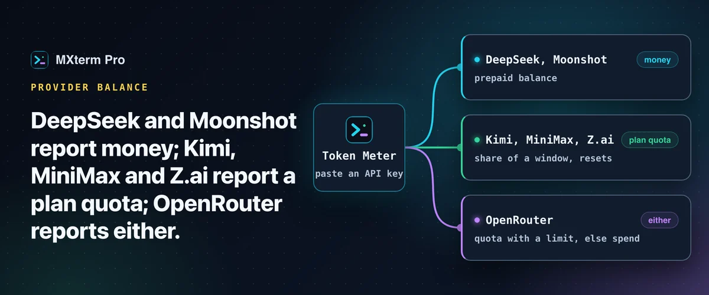

# Check AI API credit balance from your terminal



> **In short:** "credit" means three different things depending on the provider. DeepSeek and Moonshot report **money**. Kimi, MiniMax and Z.ai report a **plan quota**, a share of a window. OpenRouter reports either, depending on whether the key has a spending limit. MXterm Pro's Token Meter reads all six from one place.

## Three questions behind one word

- A **prepaid balance** is money you have paid in, drawn down per request, with no reset. DeepSeek and Moonshot work this way.
- A **plan quota** is a share of a window (per 5 hours, week or month) that refills when the window rolls over. Kimi Code, MiniMax's coding plan and Z.ai's coding plan work this way. A percentage here depends on the reset: 90% on Monday morning is worse than 90% on Sunday afternoon if the window resets Sunday night.
- **Spend** is what a key has cost so far, with no ceiling. It is the honest answer when there is no limit to be a share of, which is what an uncapped OpenRouter key gives.

## What each provider exposes

| Provider | What you get | Endpoint |
| --- | --- | --- |
| **DeepSeek** | `total_balance`, topped-up and granted credit per currency | `GET https://api.deepseek.com/user/balance` |
| **Moonshot** | `available_balance`, cash and voucher balance | `GET /v1/users/me/balance` on `api.moonshot.ai` (international) or `api.moonshot.cn` |
| **Kimi Code** | A 7-day usage quota plus shorter rate-limit windows | `GET https://api.kimi.com/coding/v1/usages` |
| **MiniMax** | Remaining plan capacity per window (`sk-cp-` key) | `GET /v1/token_plan/remains` on `api.minimax.io` or `api.minimaxi.com` |
| **OpenRouter** | The key's own `limit`, `limit_remaining` and `usage`, in USD | `GET https://openrouter.ai/api/v1/key` |
| **Z.ai** | Coding-plan quota | `/api/monitor/usage/quota/limit` on `api.z.ai` or `open.bigmodel.cn` |

Caveats worth knowing: Moonshot's response has no currency field, so the currency is inferred from the host (CNY for the China host, USD otherwise). A key belongs to one Moonshot platform and will not work on the other. Kimi's monthly "Total usage" pool comes from a cookie-authenticated web endpoint, so an API key alone does not give you that figure. Z.ai's endpoint is not in its published API reference and can change without notice, and its payload mixes the plan's token quota with a separate monthly MCP-call quota, which are not interchangeable.

## Read two of them yourself

```sh
curl -H "Authorization: Bearer $DEEPSEEK_API_KEY" https://api.deepseek.com/user/balance
curl -H "Authorization: Bearer $OPENROUTER_API_KEY" https://openrouter.ai/api/v1/key
```

Pipe through `jq` and bind it to an alias. That is a fine answer for one or two providers. It stops scaling once keys have to live in a dotfile, you have to remember to run it, and undocumented endpoints turn into scraping you maintain. Each vendor's dashboard stays the authoritative place for invoices and expiry dates, but it is a poor fit for "am I about to run out mid-task".

## What the Token Meter does with them

In **Settings → Token Meter** there is a row per provider. Paste an API key and pick a region where the provider has one; the provider then joins the popover with its balance, quota windows or spend, refreshed in the background. A balance or a spend figure never becomes a percentage or a bar. Each row says how old its reading is and what went wrong (rejected key, unreachable, rate limited, unreadable reply). If the provider is unreachable, the row keeps the last good reading and marks it stale.

## Where keys live and what never leaves

- A pasted key goes into your operating system's credential store (a macOS Keychain item MXterm Pro created itself). It is not written into the app's files or browser storage, and the field is emptied after you save.
- A second, non-secret file remembers only whether a key is saved, its last four characters and the region. With nothing configured, the meter makes no credential-store call and no network call.
- Each key goes only to hard-coded HTTPS hosts of its own provider, and redirects are not followed.
- It refuses management keys (an OpenRouter reply from a management or provisioning key is rejected), reads no browser cookies, and asks each provider at most once every five minutes; a 429 parks it for fifteen.

## Free and Pro

The Token Meter works on the Free plan.

## FAQ

**Can it show my ChatGPT or Claude subscription balance?**
Those are the Plan limits and Live Codex limits switches in the Token Meter guide, a separate source from account keys.

**Does it work offline?**
Transcript counts do. Provider balances need the network.

---

## Read more on mxterm.net

- **Full guide:** [Check AI API Credit Balance Without Opening Five Dashboards](https://mxterm.net/blog/check-ai-provider-credit-balance-terminal)
- [Token Meter page](https://mxterm.net/features/token-meter)
- **Get it:** [Download MXterm Pro](https://mxterm.net/download) for macOS, Windows and Linux, or see what [MXterm Pro](https://mxterm.net/) does in one page.

## Related guides

- [Token Meter: Claude Code and Codex usage in the title bar](token-meter.md): Tokens used, read from your agents' own transcripts.
- [Control Room: run Claude Code, Codex and Gemini CLI together](control-room.md): Let agents message each other and hand off tasks.
- [Run Claude Code and Codex in split terminal panes](split-terminal.md): Two agents, two panes, one repo, no checkout fights.

[← All guides](README.md)
