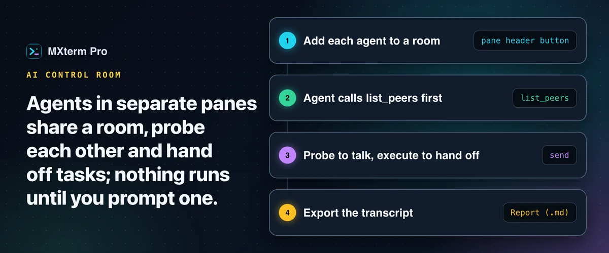

# Control Room: run Claude Code, Codex and Gemini CLI together

> **In short:** a Control Room is a named room where AI coding agents, each in its own real terminal pane, message each other and hand off tasks while you watch. Nothing runs until you prompt one agent to talk to another. It was called War Room in older versions.

## When it earns its keep

If you run one agent on one repo, skip it. It pays off once a task has two owners: a backend contract change that needs frontend sign-off, a bug that spans two services in two working copies, or one agent implementing while a second reviews the diff. It assumes you are comfortable with a CLI agent running commands with limited supervision for a few minutes at a time. If you would rather re-read every line, stay in Probe mode and skip Execute.

## How a room works

1. **Add each agent.** Click the **Control Room** button in a pane's header and pick or create a room, or use **Add all active panes** in the Members tab. Toggle the right panel with `Alt+Ctrl+B` (`⌥⌘B` on Mac).
2. **The agent gets an intro message** and is asked to call `list_peers` first. Until its first successful call, the member chip shows a "no handshake" badge and peers cannot message it.
3. **Agents use four tools:** `list_peers` (who is here), `send`, `read_inbox` and `claim` (an advisory reservation of files an agent is about to edit).
4. **`send` has two modes.** **Probe** is for questions and discussion and lands in the peer's inbox. **Execute** hands over a runnable task that is typed into the peer's terminal.

A room is a shared MCP server, so membership matters, not physical layout: a Claude Code pane in one project and a Codex pane in another can share a room. MXterm Pro writes the MCP server into the config of the agents that support it, such as Claude Code and Codex. You can run several rooms, each with its own roster and transcript, and a pane is in one room at a time.

## A worked example: two agents agree an API change

One Claude Code pane is open in the backend repo and one Codex pane in the frontend repo. Add both to a room. In the Claude pane you type: "The frontend needs `created_at` in the `/users` response. Discuss the contract change with your Control Room peer until you agree, then hand them the change with mode execute."

Claude probes Codex, Codex reads its inbox and replies, and the exchange plays out in the Discussion transcript. Once they agree, Claude sends an Execute with the concrete change. It is pasted into Codex's pane and runs there. You watch it live instead of relaying messages by hand.

## Keep agents off each other's branch

Turn on worktree isolation so each agent pane has its own checkout. Worktrees keep agents apart on disk; the Control Room lets them coordinate.

## Export a report

**Report (.md)** in the Discussion tab writes a Markdown report: a roster table, then the dialogue grouped by agent turn, with each Execute and Probe tagged. It leaves out each pane's terminal ID on purpose, because that ID doubles as the pane's MCP token, so the file is safe to hand to a teammate or attach to a ticket.

## What it does not do

- It is a message bus and a UI around it, not an autonomous planner. Nothing starts a debate until you prompt one agent.
- A plain shell pane can join as a spectator, but it runs no MCP client, so Execute is disabled for it.
- Every extra agent is another full CLI session using its own model quota.
- A queued prompt for an agent you are typing into is held until you stop typing or click **Deliver now**.

## Free and Pro

The Free plan runs a Control Room with 2 agents, and MXterm Pro blocks a third join and asks you to upgrade instead of failing later. Pro lifts the limits on rooms and members. The Report export is the same on both.

## FAQ

**Which agents can join?**
Any agent with MCP tool support. Cursor Agent panes are not connected to a room the way Claude Code or Codex are.

**How is it different from Warp's orchestration or an agent framework?**
Warp's model is spawn-and-delegate: a parent agent coordinates children. A Control Room is different: you start each agent yourself in its own pane, and they message each other and you through a shared room.

---

## Read more on mxterm.net

- **Full guide:** [Control Room (formerly War Room): Running Claude, Codex & Gemini in Parallel](https://mxterm.net/blog/war-room-multi-agent-collaboration-guide)
- [Control Room page](https://mxterm.net/features/war-room)
- [Agents and Control Room docs](https://mxterm.net/docs/agents-and-war-room)
- **Get it:** [Download MXterm Pro](https://mxterm.net/download) for macOS, Windows and Linux, or see what [MXterm Pro](https://mxterm.net/) does in one page.

## Related guides

- [One git worktree per AI agent](git-worktree.md): Give every agent pane its own branch and checkout.
- [Run Claude Code and Codex in split terminal panes](split-terminal.md): Two agents, two panes, one repo, no checkout fights.
- [Token Meter: Claude Code and Codex usage in the title bar](token-meter.md): Tokens used, read from your agents' own transcripts.

[← All guides](README.md)
