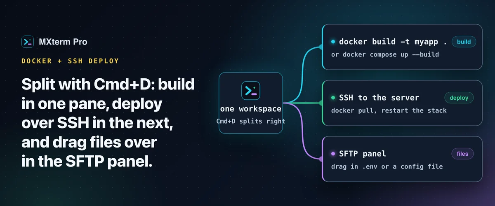

# Docker build terminal on Mac, beside your SSH deploy

> **In short:** keep `docker build` (or `docker compose up --build`) in one pane and your deploy target over SSH in the next. In MXterm Pro the split is one keystroke, and both panes are real PTYs, so `docker logs -f` and the SSH session behave exactly as on the command line. There is no Docker integration to learn.

## One pane builds, one pane deploys

Press `Cmd+D` to split the focused pane to the right, or `Cmd+Shift+D` to split down (Windows: `Ctrl+D` and `Ctrl+Shift+D`). Run `docker build -t myapp .` or `docker compose up --build` in one pane. Open or reuse an SSH session to your server in the other, ready to `docker pull` the new image or restart the stack.

Drag a pane's header toward the edge of another pane to redock it: the middle is **Swap Panes**, an edge is **Insert Left, Right, Above or Below**, and an inserted pane starts as an even 50/50. `Cmd+Shift+M` maximizes the focused pane for reading a long build log full-screen; press it again to return to the two-pane view.

## Who it helps

It fits people who build an image locally (or trigger the build over SSH) and then push or pull it onto a VPS or small cloud box by hand: indie developers, small teams without a full CI/CD pipeline, and anyone using an AI agent to iterate on a Dockerfile. If your deploy is fully automated, the second pane matters less. It earns its place in the manual middle step between "build finished" and "server is running it".

## Watch a build while an agent edits the Dockerfile

Put a coding agent (Claude Code, Codex, Gemini CLI, Copilot) in one pane and the build in the next, and re-run the build as the agent changes the Dockerfile. With **Isolate features in git worktrees** ticked, the agent edits in its own `<repo>/.worktrees/<slug>` checkout on a `swarm/<adjective>-<noun>` branch while your build pane keeps watching the plain working tree, so the agent cannot change a file your build is reading underneath you. Review and merge its change before your own build picks it up.

Command Recipes (`Cmd+J`) recognises two Docker intents: ask to list containers and you get `docker ps -a && docker stats --no-stream`; ask to clean up and you get `docker system prune -af --volumes`. It will not write a `docker build` command or work out bind-mount flags. Read a command before you click **Insert & Run**, especially the prune.

## Get a file onto the server first

Some deploys need a `.env`, a TLS certificate or a config mount on the server before the container starts. Open the server from the SSH manager so its tab has the SFTP panel, then drag the file across. If the container expects a specific mode, right-click the file, choose **File permissions…** and set the checkboxes or a preset (`755`, `644`, `777`, `600`). A `Dockerfile`, `nginx.conf` or compose file already on the server opens for editing in place with syntax highlighting. The chmod dialog and the remote editor are on the Free plan.

## Free and Pro

The Free plan has no pane limit and saves up to 5 SSH hosts. Pro removes the host cap.

## FAQ

**Does MXterm Pro have a Docker Desktop-style dashboard?**
No. It is a terminal app, so Docker commands run in a pane like any other command.

**Can I run `docker build` on a remote server?**
Yes. If you SSH into a server with Docker installed, `docker build` runs there exactly as over any SSH connection.

---

## Read more on mxterm.net

- **Full guide:** [Docker Build Terminal on Mac: Builds Alongside SSH Deploys](https://mxterm.net/blog/manage-docker-builds-in-mxterm-pro)
- [SSH and SFTP docs](https://mxterm.net/docs/ssh-and-sftp)
- **Get it:** [Download MXterm Pro](https://mxterm.net/download) for macOS, Windows and Linux, or see what [MXterm Pro](https://mxterm.net/) does in one page.

## Related guides

- [SFTP GUI and remote editor beside your terminal](ssh-sftp.md): Edit, search and chmod remote files beside the terminal.
- [Run Claude Code and Codex in split terminal panes](split-terminal.md): Two agents, two panes, one repo, no checkout fights.
- [Command Recipes: ready-made Linux commands on Cmd+J](command-recipes.md): Ten kinds of Linux task on one shortcut.

[← All guides](README.md)
