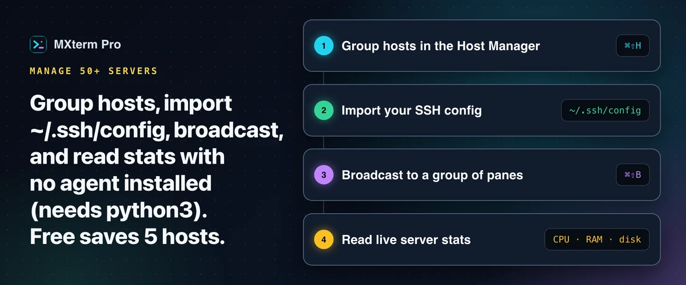

# Manage 50+ SSH servers and cloud VMs on a Mac

> **In short:** group your hosts, keep passwords in the system keychain, and read live CPU, RAM and disk numbers without installing an agent on each box. MXterm Pro's SSH Host Manager does this over real OpenSSH connections. The Free plan saves 5 hosts; Pro removes the cap.

## Who this is for

People running infrastructure across AWS, Google Cloud, DigitalOcean, Hetzner or bare metal, split between production, staging and a handful of one-off dev boxes. With one or two servers, Terminal.app and your `~/.ssh/config` are still the simplest tool. Grouping, import, broadcast and telemetry start to pay off around a dozen hosts.

## Group and filter hosts

Press `⌘⇧H` to open the **SSH Host Manager**. Each host has a name, address, port, username and one of three auth types: password, private key file or keyboard-interactive. Every host belongs to one group. Six exist out of the box (Production, Staging, Testing, Cloud / VPS, Internal / VPN, Development), you can add your own, and filter chips show a live count per group. It is a flat set of group filters, not a nested folder tree.

The **Import** button reads `Host`, `HostName`, `User`, `Port` and `IdentityFile` lines from `~/.ssh/config` into an "Imported" group in one pass. It also reads a MobaXterm session file (SSH sessions only) and an iTerm2 profile export. On Free the import stops at the 5-host cap. The importer does not translate `ProxyJump`; set a **Jump Host / Bastion** yourself in the host's form (you can chain several, separated by commas). A plain pane honours `ProxyJump` too, because `ssh prod-db` there reads your config like any terminal.

## Where credentials live

SSH passwords go to your operating system's credential store (the macOS Keychain) under the service `com.mxterm.desktop.ssh`, keyed by host id. A key passphrase is never saved. Nothing secret is written into MXterm Pro's own settings file, and a key file path such as `~/.ssh/id_ed25519` is only a path, so it stays in the host list, as in a `~/.ssh/config`.

## Why reconnecting feels instant

On macOS every connection carries `ControlMaster=auto`, `ControlPath=~/.mxterm/sockets/%r@%h:%p` and `ControlPersist=10m`: real OpenSSH multiplexing. The first connection opens a master socket; a second tab or the SFTP panel reuses it, and it stays alive for 10 minutes after the last one closes. It also lets the SFTP panel piggyback on a session you authenticated in a terminal, which matters for password hosts.

## Broadcast the same command to many servers

`⌘⇧B` turns on **Broadcast Mode** with every pane of the current tab in the group. Option/Alt+Click a pane to take it out or put it back; **Clear** empties the group, **Select all** refills it, `Esc` exits. A banner reading "Broadcast ON · N panes" stays on screen. There is no per-keystroke confirmation, so narrow the group before you type, as you would with `pssh` against a production fleet. Broadcast reaches only the panes of one tab, so to type into several servers, open plain shell panes in one tab, run `ssh <alias>` in each and broadcast to those.

## Live telemetry without an agent

The **Server Telemetry HUD** at the foot of an SSH tab shows CPU %, RAM %, disk % and uptime, coloured green, amber or red past 65% and 85%, refreshed every 20 seconds. Each refresh runs a short-lived `python3 -c "..."` one-liner over your existing connection and exits, so nothing is installed or left running on the server. It needs `python3` on the remote host; minimal images such as Alpine may lack it, and then the bar stays empty rather than showing invented numbers. RAM is read from `/proc/meminfo`, so a macOS or BSD server shows a dash.

## Free and Pro

Grouping, import, multiplexing, broadcast and telemetry work the same on both plans. The Free plan caps you at 5 saved SSH hosts; Pro has no host limit.

## FAQ

**Can I search hosts by name?**
There is no free-text search box separate from the group filters.

**Does it sync my host list to my phone like Termius?**
No. Cross-device host sync is a Termius strength; MXterm Pro is built around running agents next to your servers. See [MXterm Pro vs Termius](https://mxterm.net/vs/termius).

---

## Read more on mxterm.net

- **Full guide:** [How to Manage 50+ SSH Servers and Cloud VMs on a Mac](https://mxterm.net/blog/manage-50-ssh-servers-cloud-vms-mac)
- [SSH Host Manager page](https://mxterm.net/features/ssh-manager)
- **Get it:** [Download MXterm Pro](https://mxterm.net/download) for macOS, Windows and Linux, or see what [MXterm Pro](https://mxterm.net/) does in one page.

## Related guides

- [Prevent SSH connection timeouts on your MacBook](ssh-keepalive.md): Keepalive settings that work, and the timeouts they cannot fix.
- [SFTP GUI and remote editor beside your terminal](ssh-sftp.md): Edit, search and chmod remote files beside the terminal.
- [Command Recipes: ready-made Linux commands on Cmd+J](command-recipes.md): Ten kinds of Linux task on one shortcut.

[← All guides](README.md)
