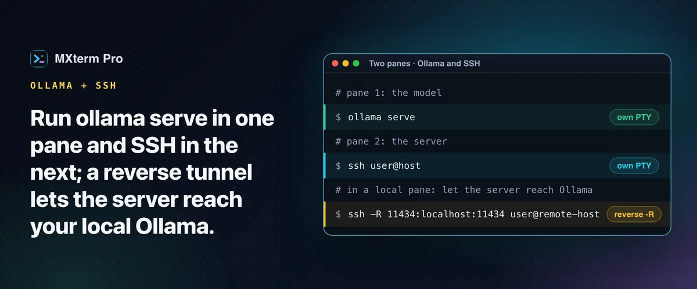

# Run Ollama in a terminal alongside SSH sessions



> **In short:** put `ollama serve` in one MXterm Pro pane and your SSH connection in the next. Both are independent PTYs in the same split workspace, so switching from the model's output to a server's logs is a click, not an app switch. The part that needs care is reaching Ollama across SSH, which takes a tunnel.

## Split the workspace

Open a workspace, split it into two panes and run `ollama serve` in one. For an interactive chat use `ollama run llama3` instead. Get SSH into the workspace from the SSH Manager (`⇧⌘H`), which opens its own tab you can split, or type `ssh user@host` in a pane. Resizing, focusing or closing one pane does not touch the other. Ollama's output (model load progress, request logs, memory warnings) stays one pane away.

MXterm Pro has no built-in Ollama integration. It runs `ollama` like any command; the benefit is having the pane next to your SSH and agent panes.

## Reach your local Ollama from a remote server

Ollama listens on `127.0.0.1:11434`, so a script on a remote box cannot reach your Mac's Ollama. Binding Ollama to `OLLAMA_HOST=0.0.0.0` would expose an API with no authentication, so use a **reverse SSH tunnel** instead:

```sh
ssh -R 11434:localhost:11434 user@remote-host
```

Then `curl http://localhost:11434/api/generate` run on the remote server reaches your local model. The remote `sshd` must allow TCP forwarding, and the port binds to the remote host's loopback only. MXterm Pro's tunnel panel only adds local (`-L`) forwards, so type this command yourself in a local pane. It is plain OpenSSH.

For the opposite case, Ollama on a remote GPU box that you want to query from your Mac, use a forward tunnel: `ssh -L 11434:localhost:11434 user@gpu-host`, then `curl http://localhost:11434/...` locally.

## RAM and GPU contention

`ollama ps` shows the loaded models and the memory each holds. A model stays in RAM (and GPU memory under Metal or CUDA) for five minutes after the last request by default; `OLLAMA_KEEP_ALIVE=10m ollama serve` changes that. MXterm Pro does not sandbox or cap what a pane's process uses, so a third pane running a coding agent that compiles a large project draws from the same RAM, CPU and GPU. On a Mac with limited memory that shared ceiling is the practical limit.

If `ollama serve` says the address is already in use, something is bound to port 11434, often a previous pane or the Ollama menu-bar app. `lsof -i :11434` shows what.

## Add a coding agent to the workspace

If an agent such as Claude Code, Codex or Cursor is generating code that calls your local model's API, run it in a third pane. With **Isolate features in git worktrees** ticked (off by default, git repos only), each agent pane gets its own checkout under `.worktrees/`, which reduces the chance two agents collide mid-edit.

Command Recipes (`Cmd+J`) does not use Ollama or any model. It is a fixed set of ready-made Linux commands matched by keyword, handy in the SSH pane for "what is using the most RAM" or "what is listening on port 11434". No recipe covers GPU memory.

## Free and Pro

Nothing here needs Pro. The Free plan has no pane limit and saves up to 5 SSH hosts. The cap matters once you manage more than 5 remote hosts.

## FAQ

**Will Ollama and an SSH session compete for resources?**
SSH is network I/O, so an idle SSH pane takes no memory or GPU from a loaded model. All panes share the Mac's total RAM, CPU and GPU, so a heavy third pane can slow things down.

**Can I keep the Ollama pane running while I close other panes?**
Yes. Panes are independent.

---

## Read more on mxterm.net

- **Full guide:** [Run Ollama in a Terminal Alongside SSH Sessions](https://mxterm.net/blog/run-ollama-alongside-ssh-sessions)
- [SSH and SFTP docs](https://mxterm.net/docs/ssh-and-sftp)
- **Get it:** [Download MXterm Pro](https://mxterm.net/download) for macOS, Windows and Linux, or see what [MXterm Pro](https://mxterm.net/) does in one page.

## Related guides

- [SSH port forwarding GUI: add local forwards on an open tab](ssh-port-forwarding.md): Add and cancel local forwards on an open SSH tab.
- [Run Claude Code and Codex in split terminal panes](split-terminal.md): Two agents, two panes, one repo, no checkout fights.
- [Command Recipes: ready-made Linux commands on Cmd+J](command-recipes.md): Ten kinds of Linux task on one shortcut.

[← All guides](README.md)
