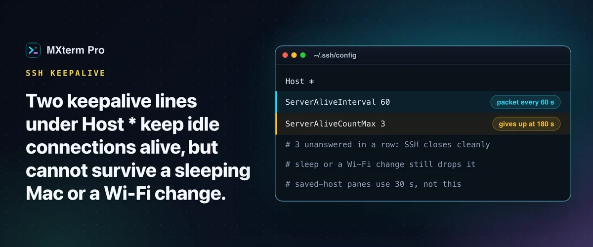

# Prevent SSH connection timeouts on your MacBook



> **In short:** add `ServerAliveInterval 60` and `ServerAliveCountMax 3` under `Host *` in `~/.ssh/config`. Your Mac's SSH client then sends a small keepalive before a router, a corporate firewall or the server's idle timer closes the connection. It will not survive sleep or a Wi-Fi change.

## Set keepalive in `~/.ssh/config`

```sshconfig
Host *
    ServerAliveInterval 60
    ServerAliveCountMax 3
```

MXterm Pro uses the `ssh` on your PATH, normally the OpenSSH that ships with macOS, so a plain pane reads this file exactly as Terminal.app does. The client now sends an "are you there" packet every 60 seconds, and if three in a row (180 seconds) go unanswered, SSH closes the connection cleanly instead of hanging on a dead socket.

Put the `Host *` block at the **bottom** of the file. OpenSSH uses the first value it obtains for each option, so a `Host *` block above your specific `Host` entries claims the setting before they are read. If a corporate firewall or public Wi-Fi prunes idle connections around the one-minute mark, use `ServerAliveInterval 30` and `ServerAliveCountMax 2`. macOS already has `TCPKeepAlive yes`, but that is a TCP-level check that can take up to two hours to notice a dead socket and does nothing against a firewall that still forwards packets while having forgotten your connection.

## Which timeout are you hitting?

- **Idle firewall or NAT timeout.** Something between you and the server drops a connection with no traffic for a few minutes. `ServerAliveInterval` fixes it if it is shorter than that window.
- **Server-side idle timeout.** The remote `sshd` hangs up idle clients, or a login shell has its own `TMOUT`. Your keepalive helps with the `sshd` case.
- **Network change.** Switching Wi-Fi, joining a VPN or moving to a hotspot changes your IP mid-session. TCP cannot survive that, and no keepalive setting fixes it. Only a protocol built for it, such as Mosh, can.
- **Sleep.** The MacBook-specific one. A sleeping Mac runs no SSH client, so no keepalive goes out, and on wake the server has often given up.

If a session must survive the lid closing, run the remote job inside `tmux` or `screen` so the job does not care that your connection dropped, then `tmux attach` when you are back.

## Fix it server-side too

If you manage the box, add `ClientAliveInterval 60` and `ClientAliveCountMax 3` to `/etc/ssh/sshd_config` and restart `sshd`. If you do not control the server, your own `ServerAliveInterval` works independently, since your client sends the keepalive traffic.

## What MXterm Pro does when a session drops

- **A plain pane:** `ssh` is the process that exits, not the shell. You land back at your Mac's local prompt in the same pane with the output still on screen; press ↑ and Enter to reconnect.
- **A pane opened from a saved host:** MXterm Pro starts `ssh -o ServerAliveInterval=30 -o ServerAliveCountMax=3`, so it notices a dead connection in about 90 seconds. Command-line options come before the config file, so your `~/.ssh/config` values do not apply to that pane. When the connection ends it prints `press Enter to reconnect`.
- **Connection sharing:** saved hosts use OpenSSH multiplexing (`ControlMaster=auto`, `ControlPersist=10m`), so opening the SFTP panel on a host you are already connected to reuses the connection and skips the handshake. The file panel has a **Reset connection** button for a server that refuses the login.

## Free and Pro

The Free plan saves up to 5 SSH hosts; Pro removes the cap. Keepalive itself is plain OpenSSH and works the same everywhere.

## FAQ

**ServerAliveInterval or ClientAliveInterval?**
`ServerAliveInterval` is a client-side setting in your `~/.ssh/config`. `ClientAliveInterval` is its server-side mirror in `/etc/ssh/sshd_config`. You need only one side; setting both is harmless.

**Why does my session still time out with it set?**
Usually because the MacBook went to sleep, not because the keepalive failed.

**How do I check it works?**
Leave a session idle longer than whatever used to disconnect it. To see the packets, run `sudo tcpdump -i en0 host <server-ip> and port 22` in a second window.

---

## Read more on mxterm.net

- **Full guide:** [How to Prevent SSH Connection Timeouts on Your MacBook](https://mxterm.net/blog/prevent-ssh-connection-timeouts-macbook)
- [SSH and SFTP docs](https://mxterm.net/docs/ssh-and-sftp)
- **Get it:** [Download MXterm Pro](https://mxterm.net/download) for macOS, Windows and Linux, or see what [MXterm Pro](https://mxterm.net/) does in one page.

## Related guides

- [Manage 50+ SSH servers and cloud VMs on a Mac](manage-ssh-servers.md): Groups, import, broadcast and live server stats.
- [SSH port forwarding GUI: add local forwards on an open tab](ssh-port-forwarding.md): Add and cancel local forwards on an open SSH tab.
- [SFTP GUI and remote editor beside your terminal](ssh-sftp.md): Edit, search and chmod remote files beside the terminal.

[← All guides](README.md)
