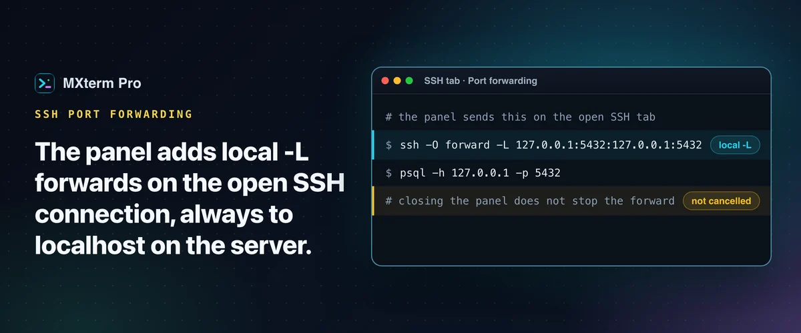

# SSH port forwarding GUI: add local forwards on an open tab



> **In short:** MXterm Pro adds and cancels local (`-L`) forwards on the SSH connection your tab already has open, always to `127.0.0.1` on the server. It has no remote (`-R`) or SOCKS option and saves no rules. It suits a database or admin-UI forward, not a tunnel you keep.

## What the panel does

Each rule goes to the running `ssh` process as a control command, so the forward rides the session you are already typing in. No second connection, no second login. You reach the panel from the SFTP panel beside an SSH tab: its header button, **SSH Port Forwarding & Tunnels Manager**, opens a window titled **SSH Port Forwarding & Tunnels**. A plain shell pane has no SFTP panel and so no forwarding button. Start sends `ssh -O forward -L <spec>` to the tab's master connection and Stop sends `ssh -O cancel -L <spec>`.

## Add a forward

1. **Open the host as an SSH tab.** `Shift+Cmd+H` opens the SSH manager, **Connect** opens a tab running the system `ssh`, and you log in as usual.
2. **Click the forwarding button** in the SFTP panel header. Under **Add New Port Forward**, fill in a name (the placeholder suggests `Postgres 5432`), a local port and a remote port (1 to 65535), then press **Add Rule**.
3. **Press Start.** The badge changes from STOPPED to **RUNNING** only after `ssh` accepts the forward. If it refuses, its own error appears in red and the badge stays STOPPED.

For Local Port 5432 and Remote Port 5432 the app sends `ssh -O forward -L 127.0.0.1:5432:127.0.0.1:5432`. Point `psql` or your database client at `127.0.0.1:5432` on the Mac and the traffic comes out at port 5432 on the server.

## Where a forward can point

Every rule targets `127.0.0.1` as the SSH server sees it: Postgres, Redis or an admin UI on the server itself. It cannot reach a third machine behind the server, because the form has no destination-host field. The Mac end is fixed to `127.0.0.1` as well, so a `GatewayPorts yes` line cannot publish a forwarded database port to your network. For a third host, type it in a normal shell pane: `ssh -L <local>:db.internal:5432 <user>@<bastion>`.

## Closing the panel does not stop a forward

The forward belongs to the SSH connection, not to the panel's list. Closing the panel only closes it, so reopening shows an empty list while the port can still be listening. Only **Stop** and the delete button cancel a forward, and ending the shared connection (**Reset connection**, editing the host's settings, or deleting it) ends every forward on it. OpenSSH decides how long the master lingers after the last session closes: every SSH tab is started with `ControlPersist=10m`, so a forward can outlive the tab by up to 10 minutes.

To find a leftover: `lsof -iTCP:<port> -sTCP:LISTEN`. To cancel it on the same master the app uses:

```sh
ssh -o ControlPath=$HOME/.mxterm/sockets/%r@%h:%p -p <port> -O cancel \
  -L 127.0.0.1:<local>:127.0.0.1:<remote> <user>@<host>
```

If the connection is gone, Start fails with ssh's own message, typically `Control socket connect(...): No such file or directory`. Open the host in an SSH tab and press Start again; the panel does not reconnect forwards.

## What it does not do

No remote (`-R`) forwards, no dynamic SOCKS proxy, no destination-host field, and rules are not saved, so nothing comes back after a reconnect. A dropped session is a keepalive question: see the SSH timeout guide below.

## Free and Pro

The panel works on the Free plan. The Free plan saves up to 5 SSH hosts; Pro removes the cap.

## FAQ

**Can I forward to a database that is not on the SSH server?**
Not from the panel. Use `ssh -L` in a pane, which is plain OpenSSH.

**Can I reach a local service from the remote server?**
That needs a reverse tunnel (`ssh -R`), also typed in a pane. The Ollama guide shows a worked example.

---

## Read more on mxterm.net

- **Full guide:** [MXterm Pro's SSH Port Forwarding GUI: Local -L Rules and What's Missing](https://mxterm.net/blog/ssh-tunneling-local-port-forwarding-mxterm-pro)
- [SSH and SFTP docs](https://mxterm.net/docs/ssh-and-sftp)
- **Get it:** [Download MXterm Pro](https://mxterm.net/download) for macOS, Windows and Linux, or see what [MXterm Pro](https://mxterm.net/) does in one page.

## Related guides

- [Prevent SSH connection timeouts on your MacBook](ssh-keepalive.md): Keepalive settings that work, and the timeouts they cannot fix.
- [Run Ollama in a terminal alongside SSH sessions](ollama-ssh.md): Local models and remote servers in one workspace.
- [SFTP GUI and remote editor beside your terminal](ssh-sftp.md): Edit, search and chmod remote files beside the terminal.

[← All guides](README.md)
