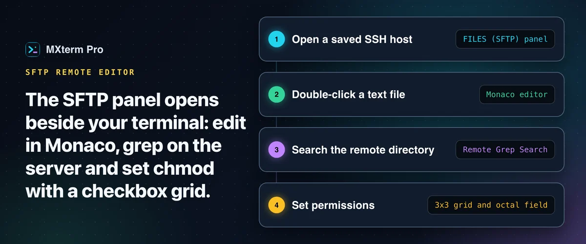

# SSH & SFTP: remote file browser and editor beside your terminal

Open a saved SSH host and a file manager is docked beside your terminal, on the left by default. Collapse it to a narrow **FILES (SFTP)** strip and click the strip to bring it back. Each open host tab keeps its own path and file list.

## Edit remote files

Double-click a remote text file to open it in a Monaco editor with syntax highlighting, not a plain text box. It treats about 90 extensions as editable text (`.env`, `nginx.conf`, `Dockerfile`, `.py`, `.ts`, `.yaml` and more). `Cmd+S` writes the file back over SFTP. Before saving, MXterm Pro compares the file's modification time with the one it saw, and if the file changed on the server meanwhile, the save is refused and you choose what to do.

## Search the server

**Remote Grep Search** runs `grep` on the server itself instead of downloading files. It is a literal-string match, not a regex, and it skips heavy directories such as `.git` and `node_modules`. Results are capped at 100 matches per file and 60 in total.

## Permissions

Right-click a file or folder and choose **File permissions…** for a 3×3 chmod grid: Owner, Group and Public against Read, Write and Execute, with an octal field.

## Upload and download

Upload with a button or by dropping files from Finder. Downloads go to `~/Downloads`. The image viewer for common formats is built in.

## Free and Pro

Nothing in the SFTP panel is Pro-only. The Free plan allows up to 5 saved SSH hosts and Pro removes that limit.

---

Full guide: [SFTP GUI and remote editor on Mac](https://mxterm.net/blog/sftp-gui-remote-editor-mac) · [SSH/SFTP page](https://mxterm.net/features/sftp-gui) · Compare: [vs MobaXterm](https://mxterm.net/vs/mobaxterm) · [vs Termius](https://mxterm.net/vs/termius)
