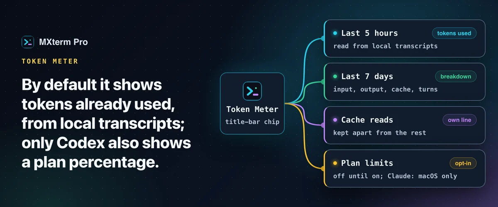

# Token Meter: see Claude Code and Codex usage in the title bar

The Token Meter is a chip in the title bar that stays visible while the app is open. Click it for a summary with one row per provider you have set up.

## What it shows

By default it shows tokens **already used**, not a forecast of what is left. The chip shows the most constrained quota anywhere, coloured by how close it is. If nothing you have configured publishes a quota, it shows the 5-hour token total of Claude Code (or Codex if Claude Code is not installed). Each row has 5-hour and weekly bars where a limit is known.

**Cache reads** get their own line. Most tokens in a long agent session are context the agent already sent, served back from the provider's cache, and counting them with everything else makes a session look far bigger than it is.

## Where the numbers come from

For token counts, the meter reads the transcript each agent keeps on your disk: Claude Code, Codex, Gemini CLI and omp. It does not call a provider's API for these, there is no key to paste, and nothing is sent anywhere. It does not read OpenCode, so it shows nothing for it rather than a guess.

## Optional switches (off until you turn them on)

- **Plan limits (Claude, macOS only)** reads Claude Code's saved sign-in from the macOS Keychain and fetches your real plan usage from api.anthropic.com, at most once every five minutes.
- **Live Codex limits** reads Codex's sign-in from `~/.codex/auth.json` and sends it only to chatgpt.com to fetch the current 5-hour and weekly windows.
- **Account balances**: paste an API key in **Settings → Token Meter** for a supported provider and it shows the balance, plan quota or spend that provider reports.

These contact the provider; the default transcript reading does not.

## Free and Pro

The Token Meter is on the Free plan.

---

Full guide: [Claude Code and Codex token usage](https://mxterm.net/blog/claude-code-and-codex-token-usage) · [Token Meter page](https://mxterm.net/features/token-meter) · [Token Meter docs](https://mxterm.net/docs/token-meter)
